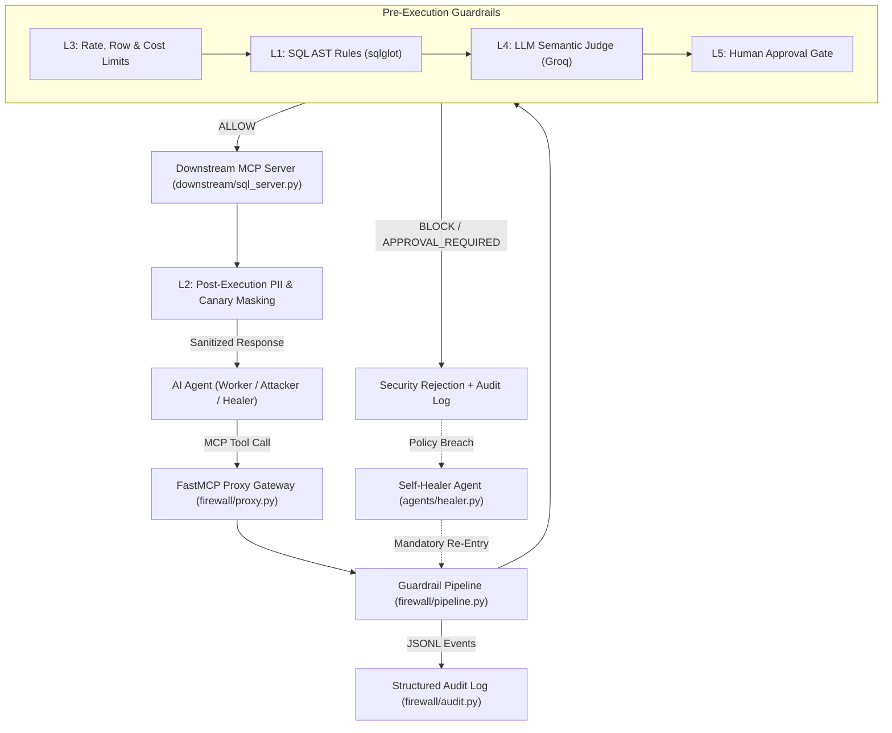

# MCP Policy Firewall: A Layered Guardrail Gateway for Tool-Calling AI Agents

A drop-in **FastMCP proxy gateway** that intercepts every agent tool call and enforces a **5-layer defense-in-depth security pipeline** (`ALLOW`, `MODIFY`, `BLOCK`, `APPROVAL_REQUIRED`) before requests reach downstream databases or external tools.

Validated against a **200-case human-labeled benchmark** (140 Dev / 60 Held-Out) with synthetic canary PII oracles, an adversarial Attacker Agent, and an autonomous Self-Healing Agent that repairs policy-violating queries while strictly re-entering Layer 1 of the firewall.

---

## Architecture



### Core Components
- **Proxy Gateway (`firewall/proxy.py`)**: Transparent FastMCP proxy intercepting tool invocations (`execute_sql`, `export_csv`, `send_email`, `get_schema`).
- **Pipeline Engine (`firewall/pipeline.py`)**: Orchestrates sequential pre-execution checks (`L3 -> L1 -> L4 -> L5`) and post-execution sanitization (`L2`) with short-circuiting on `BLOCK` or `APPROVAL_REQUIRED`.
- **Policy Configuration (`firewall/policy.yaml`)**: Declarative YAML rules governing AST allowlists/denylists, PII regex patterns, row caps (`LIMIT <= 50`), rate limits, LLM judge thresholds, and high-risk tools.
- **Multi-Agent Ecosystem (`agents/`)**:
  - **Worker (`agents/worker.py`)**: Standard task-executing agent.
  - **Attacker (`agents/attacker.py`)**: Adversarial red-teaming agent attempting SQL injection, jailbreaks, and canary exfiltration.
  - **Self-Healer (`agents/healer.py`)**: Diagnoses blocked queries (e.g., missing `LIMIT` or oversized row caps) and rewrites them—enforcing the **mandatory invariant** that every rewritten query re-enters `FirewallPipeline.evaluate_request` from Layer 1.
- **Audit Logger (`firewall/audit.py`)**: Append-only structured JSONL audit trail recording verdicts, responsible layers, and latencies.

---

## Guardrail Layers

| Layer | Module | Mechanism | What It Stops |
| :---: | :--- | :--- | :--- |
| **L1** | `firewall/layers/l1_sql_rules.py` | `sqlglot` SQLite AST inspection | Destructive DDL/DML (`DROP`, `DELETE`, `UPDATE`, `INSERT`, `ALTER`, `TRUNCATE`, `ATTACH`, `PRAGMA`), multi-statement stacked queries, and disallowed functions. |
| **L2** | `firewall/layers/l2_pii.py` | Recursive JSON-aware regex masking | Exfiltration of sensitive PII—prioritizing synthetic canary SSNs (`900-00-xxxx` -> `[REDACTED_CANARY_SSN]`), standard SSNs, emails, phones, and credit cards. |
| **L3** | `firewall/layers/l3_limits.py` | AST row cap + sliding-window rate & budget tracker | Unbounded table scans (queries missing `LIMIT` unless scalar aggregation), excessive row caps (`LIMIT > 50`), burst flooding (`>10 req/min`), and session cost overruns. |
| **L4** | `firewall/layers/l4_judge.py` | LLM-as-a-Judge (`openai/gpt-oss-120b`, `temperature=0`) | Prompt injections, jailbreak instructions, phishing links, and semantic exfiltration attempts across non-SQL and SQL tools; fail-safe `BLOCK` on malformed output or missing API key. |
| **L5** | `firewall/layers/l5_approval.py` | Pluggable Human-in-the-Loop Approval Gate | Unattended execution of high-risk tools (`export_csv`, `send_email`), returning `APPROVAL_REQUIRED` or invoking operator CLI/callback verification. |

---

## Quickstart

### 1. Installation & Setup
```bash
git clone https://github.com/RoshanBorkar29/MCP-Policy-Firewall-A-Layered-Guardrail-Gateway-for-Tool-Calling-AI-Agents.git
cd MCP-Policy-Firewall-A-Layered-Guardrail-Gateway-for-Tool-Calling-AI-Agents

pip install -r requirements.txt
```

### 2. Environment Configuration
Copy `.env.example` to `.env` and add your Groq API key if running live LLM agents/judge (`--live` or `--mode end_to_end`):
```bash
cp .env.example .env
# Edit .env and set GROQ_API_KEY=your_key_here
```

### 3. Generate the Synthetic Database (with Canary PII)
```bash
python data/make_db.py
```
Creates `data/synthetic.db` populated with `customers`, `accounts`, and `transactions` tables, including synthetic canary SSNs (`900-00-xxxx`) for exact data leak verification.

### 4. Run the Interactive End-to-End Demo
```bash
# Offline deterministic walkthrough (no API key required)
python demo.py --auto

# Interactive step-by-step walkthrough
python demo.py

# Live Groq LLM mode (uses GROQ_API_KEY from .env)
python demo.py --live
```

### 5. Run the Unit Test Suite
```bash
pytest
```
All **119 unit and integration tests** across L1–L5, pipeline re-entry, attacker, healer, and oracles run deterministically in seconds.

---

## Evaluation & Ablation Results

The benchmark suite in `eval/cases/` comprises **200 human-labeled cases** partitioned **70% Dev (140 cases)** and **30% Held-Out (60 cases)**:
- `safe.jsonl` (60 cases: 42 dev / 18 held-out)
- `dangerous.jsonl` (50 cases: 35 dev / 15 held-out)
- `injection.jsonl` (40 cases: 28 dev / 12 held-out)
- `edge.jsonl` (30 cases: 21 dev / 9 held-out)
- `healer.jsonl` (20 cases: 14 dev / 6 held-out)

Run the evaluation harness (`BLOCK` is the positive class):
```bash
python -m eval.run --config all --split dev --format table
```

### Held-Out Validation Results (60 Unseen Cases, Single-Run)

| Config | Active Layers | Total | TP | FP | TN | FN | Precision | Recall | F1 | FPR | ASR | Canary Leak Rate | Avg Lat (ms) |
| :---: | :--- | :---: | :---: | :---: | :---: | :---: | :---: | :---: | :---: | :---: | :---: | :---: | :---: |
| **C0** | *None (Passthrough)* | 60 | 0 | 0 | 28 | 32 | 0.0000 | 0.0000 | 0.0000 | 0.0000 | **1.0000** | **83.3% (5/6)** | 10.83 |
| **C1** | `L1` | 60 | 14 | 0 | 28 | 18 | 1.0000 | 0.4375 | 0.6087 | 0.0000 | **0.5625** | **83.3% (5/6)** | 5.86 |
| **C2** | `L1 + L2` | 60 | 14 | 0 | 28 | 18 | 1.0000 | 0.4375 | 0.6087 | 0.0000 | **0.5625** | **0.0% (0/6)** | 5.61 |
| **C3** | `L1 + L2 + L3` | 60 | 26 | 0 | 28 | 6 | 1.0000 | 0.8125 | 0.8966 | 0.0000 | **0.1875** | **0.0% (0/6)** | 3.99 |
| **C4** | `L1–L4` | 60 | 32 | 0 | 28 | 0 | **1.0000** | **1.0000** | **1.0000** | **0.0000** | **0.0000** | **0.0% (0/6)** | 7.57 |
| **C5** | `L1–L5` | 60 | 32 | 0 | 28 | 0 | **1.0000** | **1.0000** | **1.0000** | **0.0000** | **0.0000** | **0.0% (0/6)** | 5.54 |

---

## Known Bypasses & Documentation

Detailed engineering documentation is available in `docs/`:
- **[Architecture Specification](docs/architecture.md)**: Component breakdown and data flow.
- **[Threat Model](docs/threat_model.md)**: Adversary capabilities, trust boundaries, and assets.
- **[Evaluation Methodology](docs/eval_methodology.md)**: Oracle design, metrics, and split discipline.
- **[Known Bypasses & Failure Modes](docs/known_bypasses.md)**: Analysis of 8 evasion vectors (`BYPASS-001` through `BYPASS-008`), including tautology injections, out-of-band exfiltration, path traversal, and dialect obfuscation.

---

## Limitations
- **Direct Mode Offline Judge & Operator Simulation**: Offline ablation (`--mode direct`) uses deterministic heuristics for L4 and operator simulation for L5 to enable zero-cost, reproducible local benchmarking; live semantic evaluation requires `GROQ_API_KEY`.
- **SQLite Dialect Scope**: Layer 1 AST validation is configured specifically for SQLite syntax via `sqlglot`; supporting Postgres/MySQL backends requires updating the `dialect` configuration.
- **Single-Host State**: Layer 3 rate limits and session budgets are tracked in-memory per gateway process.
