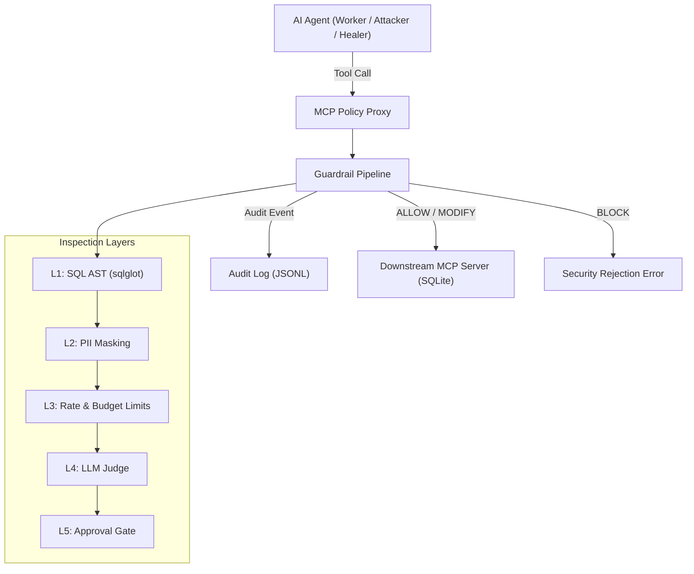

# Architecture Specification

## Overview
- Drop-in FastMCP proxy gateway intercepting client tool calls.
- Sequential five-layer guardrail inspection pipeline.
- Unified decision taxonomy: `ALLOW`, `MODIFY`, `BLOCK`, `APPROVAL_REQUIRED`.

## Components
- **Agent Client**: Generates tool invocations (Worker, Attacker, Healer).
- **Firewall Proxy Gateway (`firewall/proxy.py`)**: Intercepts MCP JSON-RPC tool calls.
- **Guardrail Pipeline (`firewall/pipeline.py`)**: Sequentially executes configured layers.
  - Layer 1: SQL AST parsing and rule enforcement (`sqlglot`).
  - Layer 2: PII regex scanning and canary masking.
  - Layer 3: Rate, row count, and cost budget limiting.
  - Layer 4: LLM semantic judge for adversarial intent.
  - Layer 5: Human-in-the-loop approval gate.
- **Audit Logger (`firewall/audit.py`)**: Structured append-only JSONL event logging.
- **Downstream MCP Server (`downstream/sql_server.py`)**: Target database and tool endpoints.

## Data Flow
- Agent initiates an MCP tool call targeting downstream services.
- Proxy captures call payload and constructs request context.
- Pipeline evaluates payload across active layers (L1 through L5).
- Short-circuit on `BLOCK` or pending `APPROVAL_REQUIRED`.
- Payload modification (e.g. PII redaction) applied when `MODIFY` triggered.
- Approved/allowed calls executed against downstream server.
- Downstream responses sanitized before returning to agent.
- Audit log records call metadata, layer decisions, and timestamps.

## Architecture Diagram

## Implementation Notes
- TODO: Finalize FastMCP stdio/SSE proxy connection multiplexing on Day 2.
- TODO: Implement layer evaluation short-circuit logic and return structures on Day 2.
- TODO: Wire interactive human approval webhook/CLI bridge on Day 5.

